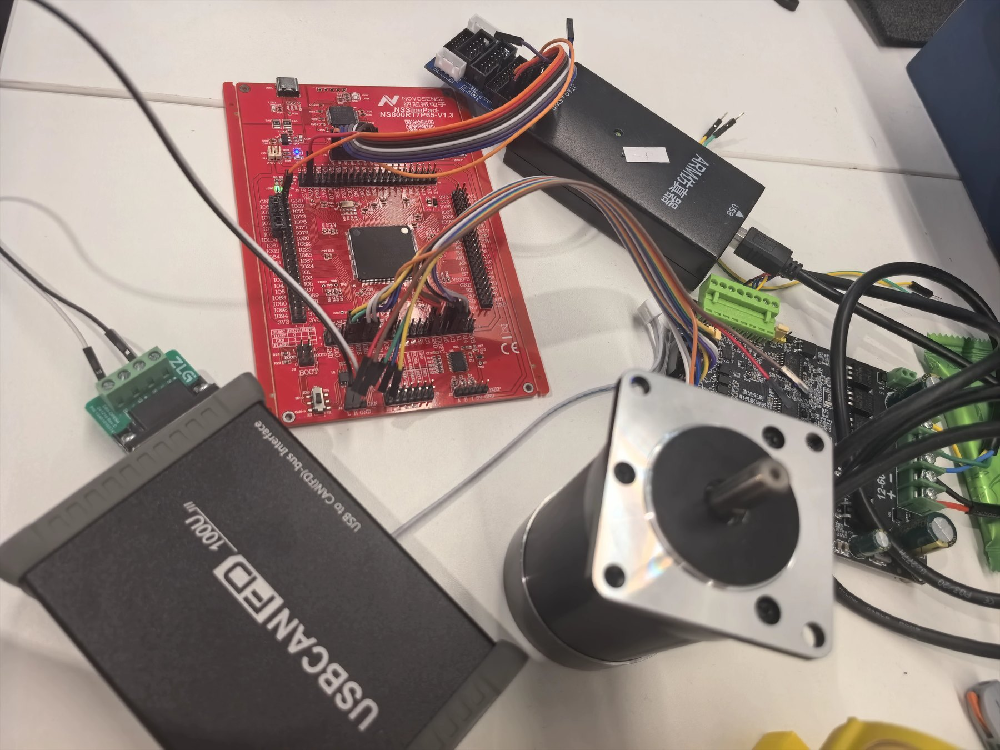
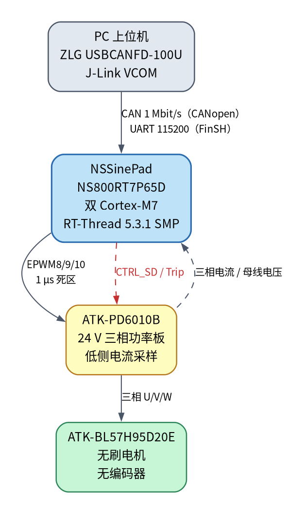
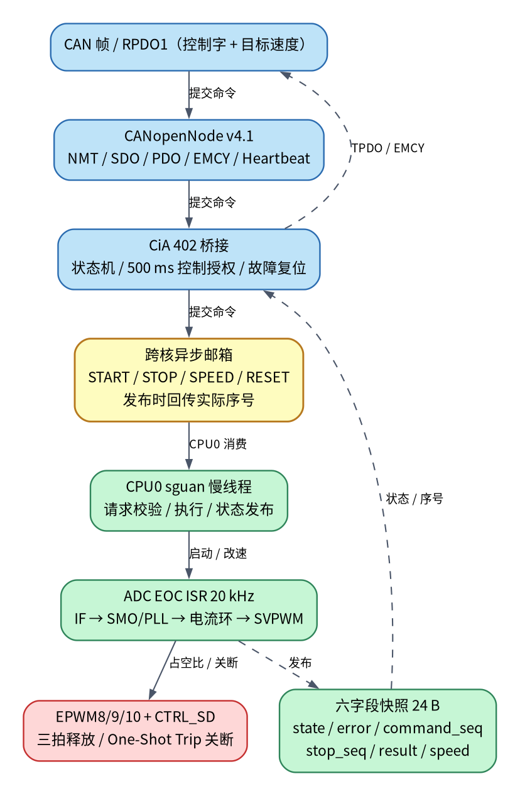

# 〖2026嵌入式大赛〗RT-Thread 双核无感 FOC 与 CANopen

> **作品类型：** 嵌入式电机控制 / CANopen 通信原型平台
>
> **硬件平台：** NSSinePad NS800RT7P65D（双 Cortex-M7）
>
> **软件平台：** RT-Thread 5.3.1 SMP + SguanFOC v3.1.0 + CANopenNode v4.1
>
> **文档版本：** 2026-10-30
>
> **开源代码：** https://github.com/illustriousness/ns800rt7p65-focdemo
>
> **演示视频：** https://github.com/illustriousness/ns800rt7p65-focdemo/releases/tag/v1.0-competition

---

## 一、项目概述

本项目围绕“嵌入式电子设计”主题，面向 24 V 无刷电机，在 NSSinePad NS800RT7P65D 上使用 RT-Thread 5.3.1 SMP，实现“控制核 + 通信核”的双核分工：

- **逻辑 CPU0（物理 CPU1）** 负责 20 kHz ADC/PWM、无感 FOC 电流环/速度环、SMO/PLL 观测器和硬件关断路径；
- **逻辑 CPU1（物理 CPU2）** 负责 UART/FinSH、CANopenNode 协议栈、CiA 402 状态机和上位机通信；
- 两核通过**异步邮箱**交接 START/STOP/SPEED/RESET 命令，通过**六字段、24 字节一致性快照**回传执行结果、故障和估算速度。

这样做的目的，是避免 20 kHz 实时控制与 CANopen/SDO/日志打印在同一核上互相抢占：电机控制不被协议栈抖动拖慢，通信核也不直接改控制器的实时变量。

项目不是只做协议状态机。当前代码已把 CANopen 控制字接到 CPU0 的真实异步 FOC 接口，并用实际命令序号、arming 状态和 FOC 状态更新 CiA 402 反馈；固件已烧录，CAN 常驻时的 UART owner 运行及安全交接已实测；**经 CAN 命令的电机启停尚未验收**。这一边界在文中单独说明。

### 作品定位

- 一个可复现的双核 RT-Thread 电机控制教学/原型平台；
- 一条从“无感 FOC 实板闭环”到“CANopen CiA 402 受限速度控制”的完整软件链路；
- 一套强调**执行确认、停止优先、故障可追溯**的安全语义，而不是“收到报文就报告使能”的演示模型。

---

## 二、功能介绍

### 2.1 双核 RT-Thread SMP

- RT-Thread 5.3.1，两个 Cortex-M7 运行同一个 SMP 内核；
- 线程可通过 `RT_THREAD_CTRL_BIND_CPU` 绑定逻辑 CPU0/CPU1；
- 使用硬件 SEMA 保护原子操作和自旋锁，MU 用于核间调度中断；
- CPU2 的 Bank2 镜像只做最小启动跳板，随后进入 Bank1 的同一套 RT-Thread 调度器；
- 双 Bank J-Link 下载、校验、冷启动、FinSH、绑核计数和 MU 中断均已在实板验证。

### 2.2 20 kHz 无感 FOC

- PWM/ADC 20 kHz，三相 EPWM8/9/10 上下计数，1 µs 死区；
- ADC EOC 中断内完成三相电流、母线电压采样，运行 SguanFOC 的高/低环；
- 启动流程为 IF 强拖 → SMO/PLL 观测 → 闭环接管；
- 板级只读监督确认闭环，10 s 未接管或持续失跟踪会触发硬件关断；
- 启动目标限 ±350～800 rpm；进入闭环后同向改速可到 ±2500 rpm；
- 正向空载已通过 UART owner 实板短测：500→1500→2500 rpm；反转、带载和经 CAN 命令的启停尚未验收；
- 速度反馈来自观测器估算，不是编码器或独立测速仪。

### 2.3 安全关断与状态语义

- 上电默认停机：GPIO23 拉低、三路 EPWM 强制 One-Shot Trip；
- 启动后保留原有“三拍输出释放”顺序，新增 `FOC_STATE_ARMING` 区分“命令已接受”和“功率级已释放”；
- STOP 只关断，不清除故障；故障复位使用独立的 `FOC_RESET_FAULT`；
- 运行中相电流达到 3.0 A、母线超出 22～27 V 或估算超速 2750 rpm 时关断；
- CPU0 在仍运行、连续 ADC 异常或电压/电流条件越界时拒绝清故障；
- 故障原因以 packed 32 位字锁存，STOP 或库状态清零不会丢失来源和库错误详情。

### 2.4 CANopen / CiA 402 受限速度控制

- NMT 从节点、Boot-up/Heartbeat、SDO Server、固定 RPDO1/TPDO1、EMCY producer；
- RPDO1：控制字 16 bit + 目标速度 32 bit，共 6 字节；
- TPDO1：状态字 16 bit + 估算机械速度 32 bit，10 ms；
- 仅支持模式 3（Profile Velocity 的受限子集）；启动目标 ±350～800 rpm，闭环同向改速到 ±2500 rpm；
- 只有 Operational 中的合法周期 RPDO 才续期 500 ms 控制授权；SDO、心跳、echo、无效报文都不续期；
- 控制字不直接等于使能：桥接等待确切 `command_seq` 成功，并等待 FOC 从 arming 进入 starting/closed，才报告 Operation enabled；
- 零目标、HALT、Quick stop、Disable voltage 或运行中反向请求先提交 STOP；
- STOP/disable/HALT 意图在进入 PDO 最新值缓冲前锁存，同一批报文后续的使能帧不能把它覆盖；
- bus-off、活动控制 RPDO 超时、实际 FOC 故障、请求失败、异常本地停止都会进入故障流程，并等待 STOP 确认；
- NMT Stop/Pre-operational/Reset 在接收时请求 STOP，清旧控制字、目标和授权，不重放旧使能；
- 故障复位上升沿单独提交 CPU0，等待实际确认；复位成功后也不自动启动。
- 默认 CAN 拥有控制权；`motor owner uart` / `motor owner can` 交接时先 STOP，
  等 CPU0 确认后才授予；UART 拥有时 CANopen 只读并报告 Disabled。

### 2.5 调试与验证工具

- FinSH：`motor status`、`motor owner [can|uart]`、`motor closed/start`、`motor speed`、`motor stop`、`motor reset`；
- `co` 查看 CANopen NMT、收发计数、错误计数和总线状态；
- `co tx` 独立发送一帧，用于链路检查；
- ZLG USBCANFD-100U 主机脚本用于经典 CAN 1 Mbit/s、SDO/PDO/NMT/EMCY/402 协议台架；
- 主机回归覆盖真实 ADC ISR、CPU0 请求/发布、CANopen 桥接状态机、启动/UART/核分工等。

### 2.6 功能与验证状态

| 能力 | 实现情况 | 验证状态 |
| --- | --- | --- |
| 双核 RT-Thread SMP、绑核、MU/SEMA | 已完成 | **实板通过** |
| 20 kHz 无感 FOC、IF→SMO/PLL、GPIO23/EPWM Trip 关断 | 已完成 | **实板通过**（正向空载至 2500 rpm） |
| CANopenNode NMT/SDO/PDO/EMCY/402 | 已完成 | **实板协议台架通过** |
| CANopen → CPU0 真实异步 FOC 桥接 | 代码已接入 | 固件已烧录；**UART owner 运行/交接实测，经 CAN 命令启停待验收** |
| CAN/UART 控制权交接（先 STOP 后授予） | 已完成 | **实板通过**（CAN 常驻） |
| 故障锁存、独立复位、STOP 优先 | 已完成 | 实板 FOC + 主机桥接回归 |
| 完整 CiA 402 Profile Velocity / 认证 | 未实现 | 明确不宣称 |

---

## 三、硬件框架说明



**图 1** 实板调试连接：NSSinePad NS800RT7P65D、ATK-PD6010B 功率板、ATK-BL57H95D20E 电机、ZLG USBCANFD-100U 与 J-Link VCOM。照片为开发阶段接线；固件上电默认关断功率级。



**图片上传提示：** 在论坛编辑器中上传 `docs/competition/hardware_setup.jpg` 和 `docs/competition/hardware_topology.png`，替换本行图片链接。

### 3.1 主要硬件

| 部件 | 型号/参数 | 作用 |
| --- | --- | --- |
| 主控板 | NSSinePad NS800RT7P65D | 双 Cortex-M7，RT-Thread SMP |
| 功率板 | ATK-PD6010B | 24 V 三相逆变、低侧电流采样、过流电路 |
| 电机 | ATK-BL57H95D20E | 24 V 无刷电机，2 极对，无编码器 |
| 调试器 | J-Link（VCOM 接 UART1） | 双 Bank 下载、SWD 调试、串口控制台 |
| CAN 分析仪 | ZLG USBCANFD-100U | 经典 CAN 1 Mbit/s，CANopen 主站/抓包 |
| 母线 | 24 V 直流 | 实测约 23.5～24 V |

### 3.2 关键引脚与资源

| 功能 | NS800 资源 | 说明 |
| --- | --- | --- |
| PWM_UH/UL | GPIO14/15，EPWM8_A/B | ALT1，1 µs 死区 |
| PWM_VH/VL | GPIO16/17，EPWM9_A/B | ALT5 |
| PWM_WH/WL | GPIO18/19，EPWM10_A/B | ALT5 |
| 三相电流 | ADCA SOC0/1/2，GPIOH3/4/5 | 低侧采样，256 点零点校准 |
| 母线电压 | ADCA SOC3，GPIOH6 | 25 倍分压 |
| 功率级使能 | GPIO23 / CTRL_SD | 高电平使能，低电平关断 |
| 调试串口 | UART1 GPIO12/13 | 115200 8N1 |
| CAN | CANFD1 GPIO4/10 | 经典 CAN，1 Mbit/s |

> 注意：CAN1 默认 GPIO18/19 与电机 PWM 冲突，因此项目使用 CANFD1；PinMux 在启动阶段完成，运行期不并行重配同一 GPIO 端口。
>
> 功率板虽包含过流电路，但当前未将 R_BREAK 配置为自动硬件 Trip 输入。GPIO23/EPWM One-Shot Trip 是由软件触发的关断路径，不构成完整硬件安全链；不能把本项目的软件保护当作安全认证。

### 3.3 功率与采样链

```text
24 V → ATK-PD6010B 三相逆变 → U/V/W → ATK-BL57H95D20E
                │
                ├─ 低侧分流 → 6 倍放大 → ADCA SOC0/1/2
                └─ 母线分压 25 倍 → ADCA SOC3
```

电流换算使用负增益，原因是低侧分流放大器为非反相输入，而“从驱动板流向电机”的正相电流在低管导通时使分流电压下降：

```text
I_phase [A] = -(raw - offset) * 3.3 / (4096 * 6 * 0.020)
VBUS [V]    = raw_vbus * 3.3 * 25 / 4096
```

---

## 四、软件框架说明



**图片上传提示：** 在论坛编辑器中上传 `docs/competition/software_flow.png`，替换本行图片链接。

### 4.1 软件组成

| 目录/组件 | 职责 |
| --- | --- |
| `rt-thread/`、`board/`、`libraries/HAL_Drivers/` | RT-Thread 5.3.1 SMP BSP、启动、UART/CAN/ADC/PWM 驱动 |
| `applications/main.c` | 启动信息、主线程、LED、SMP 压力测试入口 |
| `applications/sguan/` | SguanFOC 硬件端口、ADC ISR、命令邮箱、六字段状态、保护与 FinSH |
| `applications/canopen/` | CANopenNode 集成、OD/EDS、CiA 402 桥接、CAN 驱动适配 |
| `libraries/SguanFOC_Library/` | SguanFOC v3.1.0 浮点无感库（子模块，含本板适配） |
| `libraries/CANopenNode/` | CANopenNode v4.1（子模块，仅编译所需 301 模块） |
| `tests/` | 主机回归、ARM 编译、启动/UART/核分工/ADC/IPC/CANopen 检查 |
| `docs/` | 架构、核分工、FOC 状态、CANopen 说明和实板证据 |

### 4.2 核分工

| 资源/任务 | 执行核心 |
| --- | --- |
| ADC EOC、FOC 高低环、PWM/CTRL_SD | 逻辑 CPU0 |
| `sguan` 慢线程：初始化、启停/改速/复位、状态发布 | 逻辑 CPU0 |
| UART 收发中断、FinSH、命令解析与打印 | 逻辑 CPU1 |
| CAN 外设、CANopen 协议/OD、CiA 402 桥接 | 逻辑 CPU1 |
| 主线程、LED、通信/分析业务 | 逻辑 CPU1 |

核归属靠代码约定和启动绑定，不在每次驱动调用中增加逐次核检查。CAN ISR 只把帧送入 RT-Thread 队列，不直接改 Sguan 控制状态；控制请求统一交给 CPU0 慢线程。

### 4.3 跨核命令与状态

```c
/* 通信核发布命令，并在同一临界区取得实际序号 */
int ns800_foc_submit(enum foc_operation operation,
                     float rpm, float current, uint32_t *sequence);

/* 通信核只读六字段快照 */
int ns800_foc_status_read(struct ns800_foc_status *status);
```

快照固定为 24 字节：

| 字段 | 作用 |
| --- | --- |
| `state` | NOT_READY / CALIBRATING / IDLE / STARTING / CLOSED / FAULT / ARMING |
| `error` | 高 16 位故障来源，低 16 位库错误详情 |
| `command_seq` | 普通命令已由 CPU0 执行的序号 |
| `stop_seq` | STOP 已由 CPU0 执行的独立序号 |
| `command_result` | 对应命令的执行结果 |
| `speed` | 估算机械角速度 rad/s；停机后保留最后估计，不代表机械已停稳 |

### 4.4 CANopen 控制流程

```text
RPDO1（控制字 + 目标速度）
  → CANopenNode RPDO
  → CiA 402 状态机 / 500 ms 授权检查
  → ns800_foc_submit(START/SPEED/STOP/RESET, &seq)
  → CPU0 异步邮箱
  → sguan 慢线程校验并执行
  → ADC ISR / SguanFOC
  → 六字段快照（command_seq / stop_seq / state / error / speed）
  → CiA 402 状态字 / TPDO1 / EMCY
```

关键点：

1. **不以收包代替执行**：只有快照中的 `command_seq` 与提交序号一致且结果成功，才认为命令已执行；
2. **arming 不等于使能**：START 已接受但三拍 PWM 释放未完成时，不报告 Operation enabled；
3. **STOP 优先**：停止意图在 PDO 最新值缓冲前锁存，避免同批报文中的使能帧覆盖停止；
4. **故障不丢**：STOP 不清故障，独立复位等待 CPU0 实际确认；
5. **断联不续跑**：500 ms 无合法 Operational RPDO 或 bus-off 会请求 STOP，恢复通信也不自动重启。

### 4.5 构建与运行

```bash
git submodule update --init --recursive
scons --pyconfig-silent
./scripts/build.sh

# 仅编译/链接电机组件，不生成可下载镜像
python3 tests/sguan_arm_compile.py
```

主要回归：

```bash
python3 tests/canopen_protocol_regression.py   # CANopen/FOC 桥接（假 CPU0，ASan/UBSan）
python3 tests/foc_ipc_regression.py            # 实际 CPU0 请求/发布/故障复位
python3 tests/foc_adc_regression.py            # 实际 ADC ISR 与关断路径
python3 tests/startup_regression.py
python3 tests/uart_irq_regression.py
python3 tests/core_role_regression.py
python3 tests/sguan_integration_regression.py
python3 tests/sguan_change_review.py
```

---

## 五、关键设计与创新点

### 5.1 真正的双核职责隔离

不是“在双核上跑同一个循环”，而是把 20 kHz 硬实时控制留在 CPU0，把协议栈、SDO 分段传输、日志和 CAN 队列留在 CPU1。跨核只保留两个很小的接口：命令邮箱和状态快照，减少锁竞争和缓存一致性风险。

### 5.2 用执行确认驱动 CiA 402，而不是协议模型

很多演示把“收到控制字”直接映射成“Operation enabled”。本项目的桥接必须看到：

- 提交时的实际 `command_seq`；
- CPU0 的 `command_result == 0`；
- FOC 已离开 `ARMING`，进入 `STARTING/CLOSED`；

才报告输出允许。这样 CAN 主站看到的状态字有实际执行含义，而不是只反映协议栈自己的状态。

### 5.3 停止优先与故障可追溯

- STOP/disable/HALT 在 PDO 写入前锁存；
- NMT Stop/Pre-op/Reset 也先请求 STOP；
- 故障原因 packed 锁存，STOP 后仍保留；
- 故障复位是独立命令，成功后不自动启动；
- 本地紧急 STOP 与 CANopen STOP 合并确认时，桥接能识别更新的停止序号，不会卡在旧序号，也不会沿旧使能路径续跑；
- CAN/UART 控制权交接先 STOP，等 `stop_seq` 确认后才授予，切换期间两个来源都不能提交新命令。

### 5.4 SMO 直接反馈修正

在 SguanFOC v3.1.0 的 SMO 中，仅将硬 sign 注入移到积分前，并让电流预测器使用直接开关注入，低通输出仍供原版鉴相器/PLL 使用。保留原参数、硬 sign、IF 和 PLL，不加入边界层。

实板 A→B→A→B 对照显示：500 rpm 原始 PLL 速度标准差约 **821.60 → 142.88 rpm**，控制角 200～3000 Hz 输出纹波 RMS 约 **2.180° → 0.1068°**；800 rpm 原始 PLL 标准差约 **744.07 → 145.71 rpm**，控制角纹波约 **1.702° → 0.1874°**。这是短时空载对照，滤波速度、Iq、真实转矩/噪声/温升没有一致改善，不宣称“所有速度波动已解决”。

### 5.5 证据链完整

项目保留了失败记录、参数边界和复现命令，包括：

- 实板 FOC 串口日志、电流/ISR 数据、GPIO23 关断检查；
- CANopen 协议台架抓包、SDO/PDO/NMT/EMCY/402 记录；
- SMO A/B 对照原始 RAM/CSV/频谱结果；
- 主机回归的 ASan/UBSan 输出；
- UART owner 2500 rpm、CAN owner 交接和 BSP 等锁窗口实板日志；
- 构建、下载校验和启动布局记录。

---

## 六、验证结果

### 6.1 实板无感 FOC（短时、空载）

| 项目 | 500→600→500 rpm | 800→700→800 rpm |
| --- | ---: | ---: |
| ISR 观测峰值 | 27.185 µs | 27.470 µs |
| 相电流采样峰值 | 1.272 A | 1.189 A |
| 稳态估算误差最大值 | 13 / 14 / 15 rpm | 9 / 9 / 5 rpm |
| ADC overflow | 0 → 0 | 0 → 0 |
| 结束状态 | idle / fault=none | idle / fault=none |

> 速度为观测器低通后的估算值，不是独立机械测速；ISR 峰值为短时观测，不是严格 WCET。测试覆盖正转 500/600/800 rpm 的启动、改速、停机，未覆盖反转、堵转、带载、温升、长期和热重启。

#### 6.1.1 UART owner 扩展包络（CAN 常驻）

在 24 V、直流电源限流 2.5 A、电机固定空载条件下，CAN 线程和桥接保持运行，先 `motor owner uart`，再从 500 rpm 闭环同向升速：

| 目标 / rpm | 第一轮最大/平均误差 | 重复轮最大/平均误差 |
| ---: | ---: | ---: |
| 500 | 21 / 10.1 rpm | 29 / 17.3 rpm |
| 800 | 6 / 2.7 rpm | 7 / 4.0 rpm |
| 1500 | 7 / 2.6 rpm | 6 / 2.4 rpm |
| 2000 | 6 / 2.9 rpm | 5 / 3.3 rpm |
| 2500 | 5 / 3.1 rpm | 5 / 3.6 rpm |

两轮 ADC 相电流采样峰值分别为 1.527 A / 1.300 A，ISR 本体观测峰值 32.385 / 32.250 µs，ADC overflow 均为 0。结束时从运行状态请求 `motor owner can`，确认先 STOP 再交回；UART START 随后被拒绝。

> 这是 **UART owner** 的正向空载短测，不是 CAN RPDO 直接启停；2500 rpm 也不代表反转、带载、额定转矩或长期可靠性。详细失败记录（3000 rpm 母线掉压关断、300/250 rpm 未达误差判据）见 [速度包络与 owner 实板证据](https://github.com/illustriousness/ns800rt7p65-focdemo/blob/main/docs/bringup_evidence/sguan_speed_envelope_owner_20261030/README.md)。

### 6.2 SMO 直接反馈 A/B 对照

| 指标 | 500 rpm A1→B1 | 500 rpm A2→B2 | 800 rpm A→B |
| --- | ---: | ---: | ---: |
| 原始 PLL 速度标准差 | 821.60→142.88 rpm | 776.82→147.96 rpm | 744.07→145.71 rpm |
| 控制角 RMS（200～3000 Hz） | 2.180→0.1068° | 1.758→0.1436° | 1.702→0.1874° |
| 相电流采样峰值 | 1.452→1.260 A | 1.198→1.243 A | 1.244→1.244 A |
| ISR 观测峰值 | 26.833→27.343 µs | 25.628→27.758 µs | 26.643→28.153 µs |

> 对照顺序为 A1→B1→A2→B2；不是随机顺序或严格受控负载。控制角纹波是输出信号的高频分量，不等于真实转子角误差。

### 6.3 CANopen 协议台架（实板）

- 经典 CAN 1 Mbit/s，原始回传 **100/100** 正确；
- Boot-up、Pre-operational/Stopped 心跳、SDO 加速/分段/abort；
- RPDO/TPDO、NMT、EMCY、402 状态迁移、fault-reset 边沿、NMT reset；
- ZLG 侧 RXE=0、TXE=0；
- 独立抓包确认 `0x456 / 8081828384858687`，不只依据 MCU 计数。

### 6.4 CANopen → FOC 桥接（主机回归）

使用确定性假 CPU0，覆盖：

- 延迟/拒绝命令确认；
- START 已接受但仍在 arming；
- 同方向改速合并、零目标/反向先停止；
- 同一批报文 STOP 后跟使能帧的优先级；
- SDO disable/quick-stop/HALT 锁存；
- NMT Stop/Pre-op/Reset 不重放旧使能；
- 500 ms 控制授权超时、bus-off、链路恢复不自动重启；
- 故障锁存、独立复位、复位失败保持；
- 本地紧急 STOP 合并确认和序号回绕。

**边界：** 以上桥接状态机结果来自主机 ASan/UBSan 回归。固件已烧录，并在 CAN 常驻时完成 UART owner 的启动/改速/停机及控制权交回实测；但**尚未用 CAN 命令完成电机启停/改速/断联实板验收**。

### 6.5 构建与静态检查

- 完整固件构建通过：CPU1 `text=175764`、`data=5616`、`bss=39352` 字节；FLASH 使用 171164 B / 512 KB（32.65%）；
- CPU2 引导镜像构建通过；
- ARM 电机组件独立编译 + 可重定位链接通过；
- 启动布局、UART 中断、核分工、ADC ISR、IPC、Sguan 模型和源码一致性检查通过；
- `git diff --check`、OD/EDS 生成一致性检查通过。

---

## 七、演示视频

**视频链接：** https://github.com/illustriousness/ns800rt7p65-focdemo/releases/tag/v1.0-competition

**直接下载：** https://github.com/illustriousness/ns800rt7p65-focdemo/releases/download/v1.0-competition/ns800_uart_demo_20261030.mp4

视频为 25 s、1080p30 的实板短演示：

1. UART owner 下 500 rpm 启动，IF 强拖 → SMO 接管；
2. 闭环后同向升速 1500 rpm、2500 rpm；
3. 运行中请求交回 CAN owner，先 STOP 再授予；
4. 字幕注明速度来自 SMO/PLL 估算，2500 rpm 为 24 V、直流限流 2.5 A、正向空载短测。

> 该视频是 **UART owner** 演示，不是 CAN RPDO 直接启停；经 CAN 命令的电机运行仍需单独验收。视频中的转速为观测器估算值，不是独立测速。

---

## 八、开源代码与复现

- **仓库：** https://github.com/illustriousness/ns800rt7p65-focdemo
- **分支/标签：** v1.0-competition
- **许可证：** Apache-2.0（与 RT-Thread 一致；SguanFOC 保留 MIT，CANopenNode 保留 Apache-2.0）
- **SguanFOC 适配：** `patches/sguan-ns800.patch`（上游子模块 + 补丁，不依赖私有 fork）
- **硬件资料：** 见公开仓库 `docs/` 与硬件接线表
- **EDS：** `applications/canopen/NS800_FOC_BRIDGE.eds`
- **实板证据：** `docs/bringup_evidence/`、`docs/canopen_evidence/`

复现步骤：

```bash
git clone https://github.com/illustriousness/ns800rt7p65-focdemo
cd ns800rt7p65-focdemo
git submodule update --init --recursive
git -C libraries/SguanFOC_Library apply ../../patches/sguan-ns800.patch
scons --pyconfig-silent
./scripts/build.sh
```

下载与串口：

```bash
export JLINK_SN=<J-Link序列号>
./scripts/jlink_flash.sh

tio -b 115200 -f none --no-reconnect /dev/serial/by-id/<J-Link设备>
```

> 本仓库已包含 `patches/sguan-ns800.patch`；克隆后按上面命令应用即可。只发布父仓库 gitlink 而不提供补丁，无法复现本项目的控制算法。

---

## 九、已知限制与后续工作

1. **经 CAN 命令的电机启停尚未验收**：固件已烧录，CAN 常驻时 UART owner 的启动/改速/停机及交回 CAN 已实测；但 CAN RPDO 直接启停/断联仍需单独验收。
2. **无编码器/Hall**：速度是 SMO/PLL 估算值，不能据此判断机械完全停稳；反向重新使能前需人工确认。
3. **受限速度控制**：仅模式 3；启动 ±350～800 rpm，闭环同向改速到 ±2500 rpm；零目标/HALT/反向先停止；没有零速保持、直接跨零换向、完整加减速轨迹或位置模式。
4. **非完整 CiA 402**：未实现 Profile Velocity 的全部对象和一致性认证；`0x605A=0` 的 Quick stop 是立即失能，不是受控减速。
5. **500 ms 超时是任务级处理**：不替代独立硬件看门狗或安全急停；核心死锁时没有独立关断保证。
6. **测试边界**：实板 FOC 为 24 V、直流限流 2.5 A、正向空载短测；2500 rpm 已通过 UART owner 短测，但未覆盖反转、堵转、带载、温升、长期、热重启和 CAN 通信压力；ISR 峰值为观测值，不是严格 WCET。
7. **SMO 修正的边界**：显著降低原始 PLL/控制角高频纹波，但滤波速度、Iq、真实转矩、噪声、效率没有一致改善结论。

后续计划：完成 CANopen 桥接的实板分级验证（先停机/空载、再轻载）、补充硬件急停链、增加 Hall/编码器选项、完善 CiA 402 对象和一致性测试。

---

## 十、致谢

感谢 RT-Thread 团队和社区提供的 RT-Thread 5.3.1、BSP 框架、FinSH 和丰富文档；感谢 CANopenNode 提供开源 CANopen 协议栈；感谢 SguanFOC 作者提供 v3.1.0 无感 FOC 库；感谢 NOVOSENSE 提供 NS800 SDK、J-Link Flash loader 和芯片资料；感谢正点原子提供 ATK-PD6010B 功率板与电机资料。

本项目在开发过程中保留了失败记录和验证边界，希望这个平台能为后续双核电机控制、CANopen 驱动和教学实验提供一个可复现的起点。

---

### 附：材料索引

| 材料 | 位置 |
| --- | --- |
| 论坛帖子（本文） | 本文（发布后回填） |
| 项目概述/功能介绍 | 本文第一、二节 |
| 硬件框架 | 本文第三节 + 图 1、图 2 |
| 软件框架 | 本文第四节 + 图 3 |
| 开源代码 | https://github.com/illustriousness/ns800rt7p65-focdemo |
| 演示视频 | https://github.com/illustriousness/ns800rt7p65-focdemo/releases/tag/v1.0-competition |
| CANopen EDS | `applications/canopen/NS800_FOC_BRIDGE.eds` |
| 实板 FOC 证据 | `docs/bringup_evidence/sguan_upstream_reuse_20261029/`、`docs/bringup_evidence/sguan_smo_direct_feedback_20261030/` |
| CANopen 台架证据 | `docs/canopen_evidence/` |
| 构建/测试命令 | 本文第 4.5 节、`docs/CANOPEN.md`、`docs/FOC_STATUS.md` |
